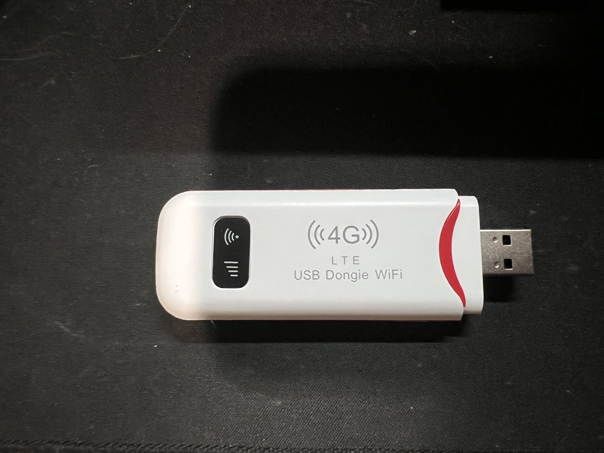
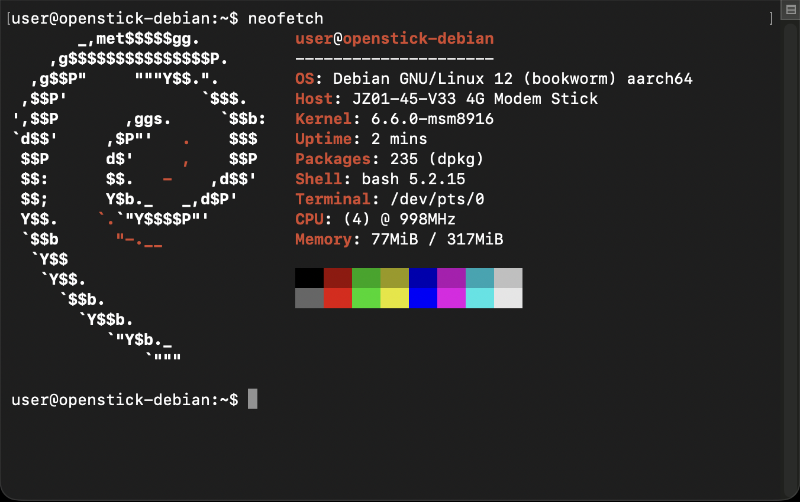
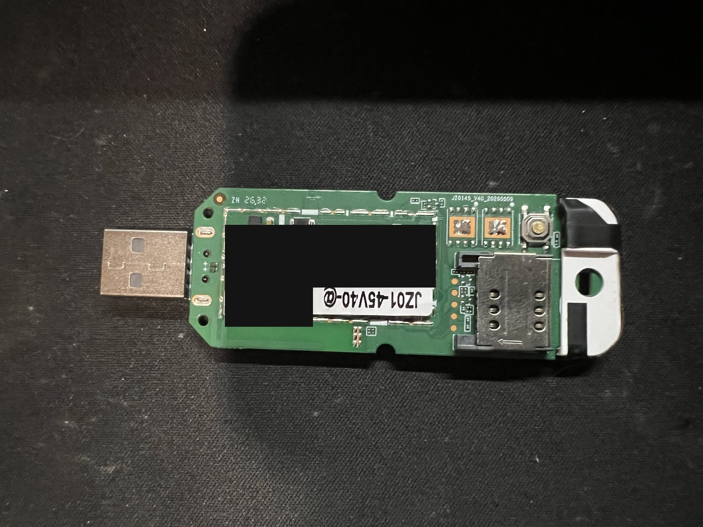
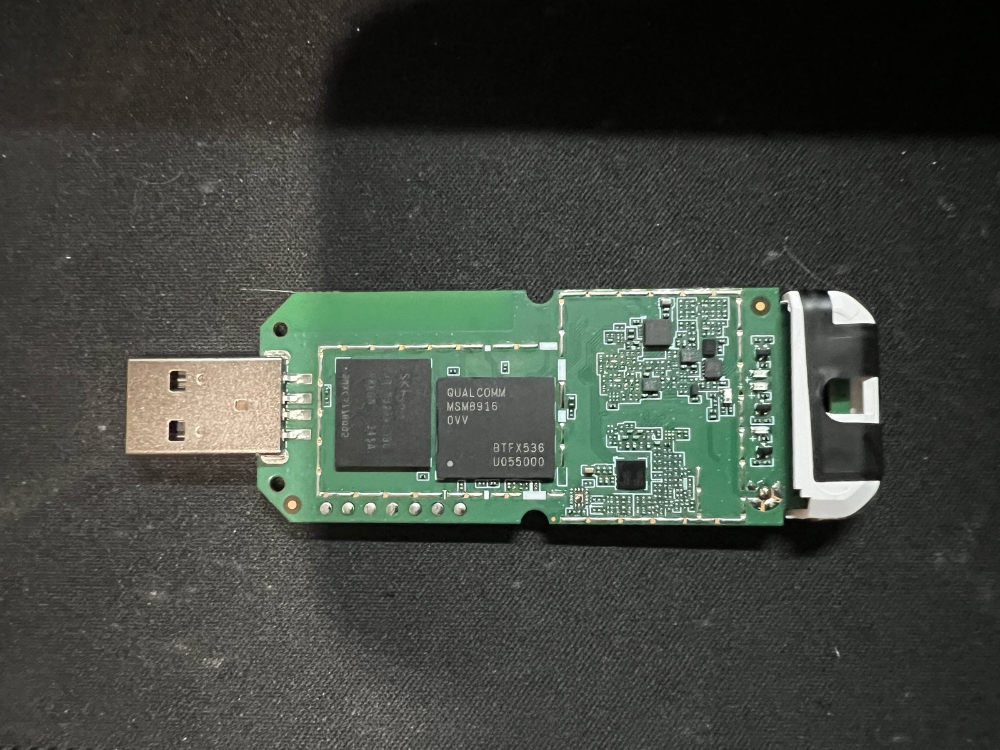

# OpenStick Debian on the JZ0145 v40 4G dongle

How to turn a **JZ0145 v40** USB 4G/WiFi dongle (Qualcomm MSM8916) into a small Debian 12 Linux box, using [OpenStick](https://github.com/kinsamanka/OpenStick-Builder).

Earlier guides cover the **v33** board. This repo records what it took to get **v40** working, including the step most guides skip and the approaches that failed.

<p align="center">
  
  
</p>

> [!WARNING]
> This replaces the bootloader and partition table. It can leave the dongle unbootable until you restore it through EDL. Back up first and keep the backup.

## TL;DR

- **The v33 device tree works on v40.** Use `msm8916-jz01-45-v33.dtb`.
- **Flash the `cdt` partition** with `sbc_1.0_8016.bin`. The OpenStick-Builder README leaves this out. Without it the DragonBoard 410c `sbl1` cannot bring up RAM on this board, and the dongle falls straight back to EDL.
- Recovery is always possible: hold the reset button while plugging in to get EDL mode (`05c6:9008`).

## Board

| | |
|---|---|
| PCB marking | `JZ0145_V40_20260509` (label `JZ01-45V40`) |
| SoC | Qualcomm MSM8916 (Snapdragon 410), secure boot **off** |
| RAM / eMMC | 512 MB / 3.7 GB (SK hynix package next to the SoC) |
| Stock OS | Android 4.4.4 (KTU84P), web UI `UFI-JZ_V3.0.0` at 192.168.100.1 (admin/admin) |
| Modem firmware | MPSS.DPM.2.0.c12 |
| EDL | hold the reset button while plugging in |

| Label side (reset button, SIM slot) | SoC side |
|---|---|
|  |  |

The reset button used for EDL is the small tactile switch next to the SIM slot. The sticker's IMEI/serial area is blacked out in the photo.

## Result

Tested on one v40 board:

| | |
|---|---|
| OS | Debian 12, kernel `6.6.0-msm8916` (from OpenStick-Builder v0.2) |
| Device tree | `JZ01-45-V33 4G Modem Stick` |
| WiFi AP | ✅ `Openstick` / `openstick`, 192.168.4.1 |
| LEDs | ✅ `red:power`, `green:wlan`, `blue:wan` |
| Modem | ✅ detected by ModemManager with the original IMEI |
| SIM / 4G | ✅ after the [SIM GPIO fix](#sim-fix-v40) below. LTE on a Thai carrier at about 11 Mbit/s down and 7.6 Mbit/s up, shared to the WiFi AP. |
| USB network | ⚠️ the default gadget is RNDIS: works on Linux and Windows, no driver on macOS. See [USB networking on macOS](#usb-networking-on-macos). |

## Requirements

- [bkerler/edl](https://github.com/bkerler/edl) (needs Python ≥ 3.10 and libusb)
- `fastboot` (Android platform-tools)
- `e2fsprogs` (for `debugfs`), `python3`, `curl`, `unzip`
- About 5 GB of free disk for the backup and images

## Install

```bash
git clone https://github.com/yeet2042/jz0145-v40-openstick
cd jz0145-v40-openstick
./flash.sh            # all stages
./flash.sh --help     # or run stage by stage
```

`flash.sh` repeats the steps that worked by hand. It has **not** been run end-to-end as a single script. Read it first. If you're unsure, run it one stage at a time:

| Stage | Mode | What it does |
|---|---|---|
| `prepare` | – | Downloads OpenStick-Builder v0.2 (checksum-verified) and points `extlinux.conf` at the v33 dtb |
| `backup` | EDL | `edl rf orig_fw.bin` plus `fsc fsg modem modemst1 modemst2 persist sec` |
| `lk1st` | EDL | Writes lk1st to `aboot`, zeroes the `boot` header, resets into fastboot |
| `flash` | fastboot | Flashes `gpt_both0`, `aboot`, `hyp` (qhypstub), `rpm`/`sbl1`/`tz` (db410c), **`cdt`**, `boot`, `rootfs` |
| `restore` | fastboot | Flashes the OEM partitions back (IMEI and calibration), then reboots |

After about a minute, join WiFi **`Openstick`** (password `openstick`):

```bash
ssh user@192.168.4.1        # password: 1  (change it!)
sudo resize2fs /dev/disk/by-partlabel/rootfs   # use the whole eMMC
```

## SIM fix (v40)

With the v33 device tree, the modem on v40 reports the SIM as missing (`qmicli --uim-get-card-status` shows `Card state: 'absent'`, and ModemManager shows `sim-missing`). The SIM switch pins are wired differently on v40. The stock Android device tree (`gpio-leds` nodes `sim1_switch_gpio`, `sim2_switch_gpio`, `sim3_switch_gpio`, `sim_hotdet_gpio`) sets:

| GPIO | stock v40 | v33 dtb |
|---|---|---|
| 1 | low | high |
| 22 | **high** | low |
| 23 | **high** | low |
| 52 | **high** | not set |

[`extras/jz-sim.service`](extras/jz-sim.service) applies the stock values at boot and power-cycles the SIM so the modem picks it up. It needs `gpiod` and `libqmi-utils` on the dongle:

```bash
sudo apt install gpiod libqmi-utils
sudo cp jz-sim.service /etc/systemd/system/
sudo systemctl enable --now jz-sim.service
sudo systemctl restart ModemManager
```

Then set the APN on the `lte` connection that OpenStick ships. Some carriers reject plain `ipv4`, so keep IPv6 enabled (`ipv4v6`):

```bash
sudo nmcli con mod lte gsm.apn internet ipv6.method auto ipv4.route-metric 30
sudo nmcli con up lte
```

Notes:
- Don't make the service depend on `dev-wwan0qmi0.device`. That unit never becomes active, and boot stalls about 90 s waiting for it. The service polls for `/dev/wwan0qmi0` instead.
- A proper fix would be a v40 device tree with these pin states. Patches welcome.

## USB networking on macOS

macOS has no RNDIS driver. [`extras/usb-ecm-gadget`](extras/usb-ecm-gadget) switches the USB gadget to CDC-ECM, which macOS supports natively. Install it as `/usr/local/sbin/usb-ecm-gadget` (mode 755), plus this override at `/etc/systemd/system/usb-gadget.service.d/ecm.conf`:

```ini
[Service]
Type=oneshot
ExecStart=
ExecStart=/usr/local/sbin/usb-ecm-gadget start
ExecStop=
ExecStop=/usr/local/sbin/usb-ecm-gadget stop
```

Set the dongle's `usb` connection to DHCP, so the Mac's Internet Sharing (enable it for "JZ0145 ECM") can hand it an address. `192.168.5.1` is a static fallback address:

```bash
sudo nmcli con mod usb ipv4.method auto ipv4.addresses 192.168.5.1/24 ipv4.route-metric 50 ipv4.dhcp-timeout infinity
```

## Gotchas found along the way

- **`edl e boot` didn't erase anything** on this board. The script overwrites the first MiB of `boot` instead.
- **`edl reset` often drops the USB connection without rebooting.** If nothing appears, unplug and replug.
- On stock Android, ADB is already enabled over USB (`05c6:9024`), so `adb reboot edl` works without opening the case.
- The web UI has no USB-debug page (`/usbdebug.html` returns 404). The API lives at `/api/...`, and `/api/system/fun` with `type=1` is a **factory reset**, so don't poke it.

## Things that did *not* work on v40

Listed so the next person can skip them:

| Attempt | Result |
|---|---|
| OpenStick-Builder README as written (no `cdt`) | Falls to EDL right after reboot |
| Stock `sbl1`/`tz`/`rpm` with the OpenStick GPT | Falls to EDL (stock sbl1 needs the stock layout, e.g. the `DDR` partition) |
| lk1st + qhypstub on stock `sbl1`/`tz`/`rpm` | Hangs, solid red LED, no USB |
| Stock bootloaders + [lk2nd](https://github.com/msm8916-mainline/lk2nd) 23.1 in `boot` + mainline kernel (6.6 and pmOS 6.12) | lk2nd works and even detects the board as `xiaoxun,jz0145-v33`, but every mainline kernel hangs early and the watchdog resets it after ~15 s. Removing `earlycon`, `nosmp`, `cpuidle.off=1`, and changing `rootdelay` made no difference. The stock Android kernel boots fine through the same lk2nd. Likely the stock RPM/TZ firmware vs. mainline, which is why OpenStick swaps in the db410c firmware. |

## Restore stock Android

From EDL mode:

```bash
edl wf backup/orig_fw.bin
```

## Credits

- [kinsamanka](https://github.com/kinsamanka): [OpenStick-Builder](https://github.com/kinsamanka/OpenStick-Builder) and the [JZxx install gist](https://gist.github.com/kinsamanka/0b01cd02412bd13ee072072043d46fa2). The working recipe (db410c firmware + `cdt` + qhypstub + lk1st) comes from that gist.
- [msm8916-mainline](https://github.com/msm8916-mainline): lk2nd, qhypstub and mainline kernel work, and [postmarketOS](https://postmarketos.org) for the kernel packages.
- [bkerler/edl](https://github.com/bkerler/edl): Qualcomm EDL tooling.
- The v40 port, debugging, `flash.sh` and this README were done together with **Claude (Opus 5.5)** by Anthropic, working in [Claude Code](https://claude.com/claude-code).

## License

The scripts and docs in this repo are MIT licensed (see [LICENSE](LICENSE)). Firmware and images are downloaded from their original sources at install time and are not redistributed here.
